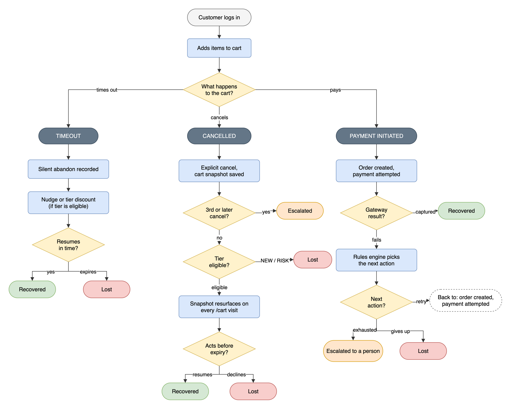
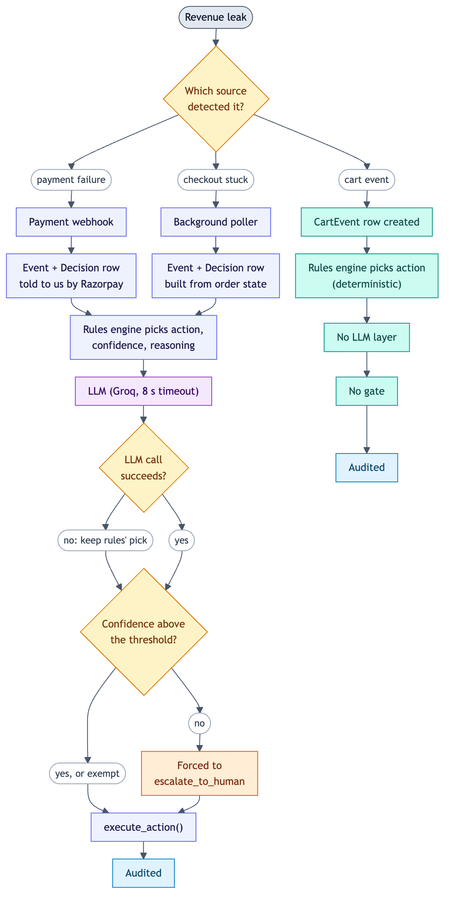
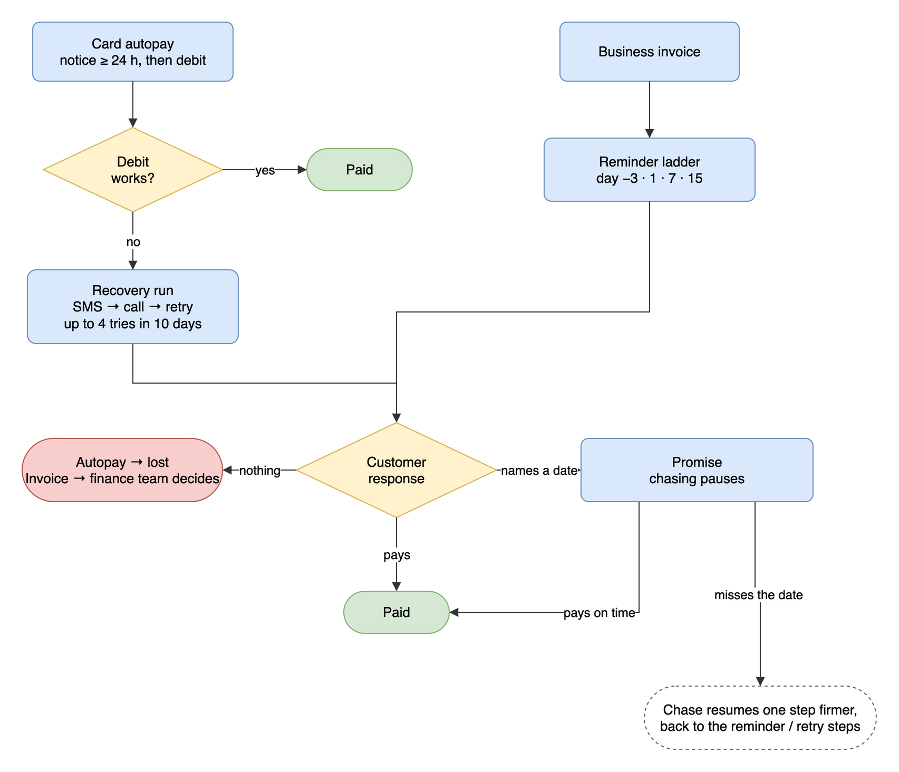
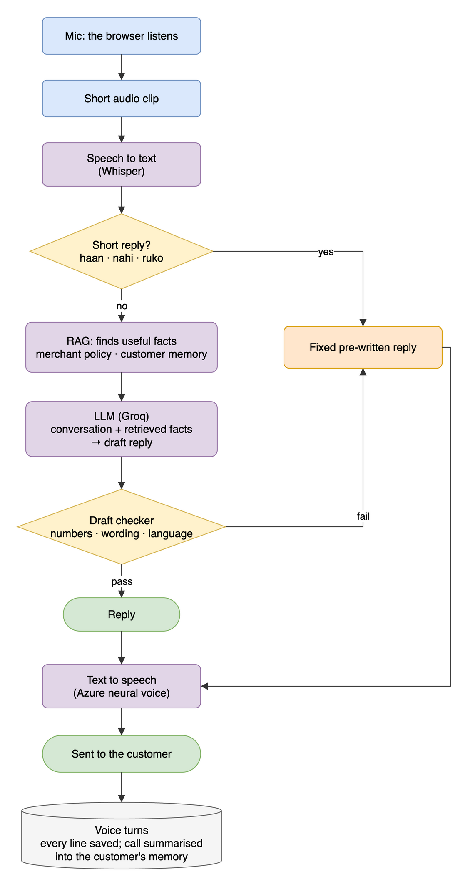

# Backstop — AI Revenue Recovery Agent

An event-driven system that finds revenue slipping away — a failed payment, an abandoned checkout, a bounced card autopay, an overdue invoice — and
wins it back inside strict, auditable limits. FastAPI + PostgreSQL + Razorpay (Test Mode), with a React merchant dashboard, a customer storefront and
an autopay page.

**The design in one paragraph.** A deterministic rules engine decides first. A language model may only *refine* that decision (adjust confidence and
wording; never pick an action outside a closed set, never a money amount). Risky or low-confidence cases go to a human. Every state change and every
rupee that moves is written once, through one function, to an append-only hash-chained audit log. Customers are contacted only within consent,
calling-hours and frequency guardrails enforced in code, not in prompts.

| | |
|---|---|
| **Backend** | Python 3.12 · FastAPI · SQLAlchemy 2 · PostgreSQL |
| **Frontend** | React 19 · TanStack Router/Query · Vite · Tailwind 4 · shadcn/radix |
| **AI** | Groq function-calling · local embeddings + pgvector/numpy retrieval · Azure neural TTS · Whisper STT |
| **Payments** | Razorpay Test Mode: Orders, Checkout, Payment Links, card mandates, HMAC-verified webhooks |
| **Quality** | 44 unit tests · 14 offline eval suites (~970 cases) · 1 live-model suite · 26 mutation self-tests |

> **Status.** Everything runs end to end against Razorpay **Test Mode**. SMS, OTP, the DND registry and the phone line are *simulated* (the browser is
> the phone). See [What is real and what is simulated](#what-is-real-and-what-is-simulated). `ENVIRONMENT=production` refuses simulated providers.

## Project structure

```
app/         FastAPI backend: signals (webhook, dropoff, storefront), rules_engine, llm_agent, actions,
             tiering, revenue, audit, scheduler, autopay, promises, receivables, voice*, memory*, insights*
frontend/    React SPA: dashboard, storefront, portals, Simulation Console
scripts/     seeders, reset, webhook simulator, Razorpay probe
sql/         idempotent column / enum migrations
evals/       offline eval suites, live suite, mutation self-test      tests/   unit tests
data/        store_policy.md (the voice agent's approved knowledge)   docs/    diagrams (.drawio + .png)
```

---

## What it does

| Capability | What happens |
|---|---|
| **Payment-failure recovery** | A `payment.failed` webhook becomes an `Event`; rules pick retry / nudge / escalate; a bounded LLM may adjust confidence; a gate can force a human. |
| **Checkout drop-off recovery** | A poller finds orders created but never paid and runs the same pipeline. |
| **Cart recovery** | Carts abandoned before any Razorpay order exists; silent abandon vs explicit cancel are different signals; discounts come from a per-tier formula. |
| **Customer tiering** | An engagement score places customers on NEW / RISK / CASUAL / REGULAR / LOYAL and sets effort and discount. |
| **Card autopay recovery** | Real card mandates; a failed debit opens a run with dated retries, notices, a call and a re-mandate link. |
| **Promise-to-pay** | A customer names a date; chasing pauses; a broken promise resumes one step firmer. Never moves money itself. |
| **B2B receivables** | Overdue invoices on Payment Links, a firming chase ladder, disputes, write-offs by a person. |
| **Hinglish voice agent** | Multi-turn calls in English / Hindi / Hinglish, grounded in merchant policy and consented memory. |
| **Policy analytics** | Four LLM analyses propose settings changes with evidence; the merchant previews and applies them. |
| **Simulation Console** | Step any debt through its whole life with the real scheduler and guards. |

---

## Architecture

**Request lifecycle (payment failure).** `POST /webhooks/razorpay` verifies the HMAC signature, dedupes on the `X-Razorpay-Event-Id` header, writes an
`Event` and returns `accepted`. A background task then runs: rules → bounded LLM → confidence gate → action → audit entry at each step. Recovery is
confirmed only by a later `payment.captured` webhook or an HMAC-verified checkout callback, never by the action layer.

**Four background threads** start at boot; each exists because some money or message would otherwise have no exit.

| Thread | Interval | Purpose |
|---|---|---|
| `dropoff-poller` | 10 min | Orders stuck in `attempted` past the abandonment window |
| `cart-idle-sweep` | 5 min | Carts idle 30+ min → silent-abandon pipeline |
| `maintenance-sweep` | 30 min | Stale orders → abandoned; tier refresh; lapses dead recovery paths so no rupee stays "at risk"; memory expiry |
| `scheduler` | configurable | Fires durable `ScheduledAction` rows (retries, notices, chases, calls, debits) exactly once |

| The model **may** | The model **cannot** |
|---|---|
| Adjust confidence and rewrite reasoning | Choose an action outside the `AgentAction` enum (tool schema) |
| Classify a call transcript into a fixed intent | Pick or alter a money amount — discounts are a formula |
| Draft a spoken reply that code then validates | Skip the validator: a rejected reply falls back to fixed text |
| Propose policy changes | Apply them, or touch a setting outside the whitelist |

Any model failure (timeout, bad tool call, rate limit, `/debug/toggle-llm-failure`) falls back to rules or a fixed template with an
`llm_failure_fallback` audit entry. Nothing crashes and nothing goes silent.

---

## Consumer recovery: the decision pipeline

| Signal | Entry point | Rules function | Rows written |
|---|---|---|---|
| **Payment failure** | `webhook.py` (Razorpay pushes it) | `rule_based_decision` | `Event` + `Decision` |
| **Checkout drop-off** | `dropoff.py` (poller; abandonment is the *absence* of a paid status) | `rule_based_dropoff_decision` | `Event` + `Decision` |
| **Cart event** | `storefront.py` (no Razorpay order exists yet) | `rule_based_cart_event_decision` | `CartEvent` only |

Every signal follows: **record → rules decide → LLM refines (bounded) → confidence gate → `execute_action` → audit.** Below `confidence_threshold`
(**0.70**) a decision is forced to `escalate_to_human`. Payment failures exempt `escalate_to_human` and `retry_now` from the gate (gating `retry_now`
would kill the unknown/invalid-card path); drop-offs exempt only `escalate_to_human`; cart events have no LLM and no gate. `actions.py` is a stub layer
and never reports "recovered".

### The customer's journey in the store

<p align="center"></p>

"Give up" is its own ending on the failed-payment thread, not a cart cancel: the order stays failed and only its `risk_settled` flag changes.

### The decision pipeline

<p align="center"></p>

---

## Rules, tiering, incentives, money, audit

Thresholds are read live through `runtime_flags`, so a change applied from the analytics layer takes effect without a restart.

### Decision rules (first match wins)

| Payment failure condition | Action |
|---|---|
| attempts > 3 | `escalate_to_human` (checked first, above even `risk_block`) |
| amount ≥ ₹5,000 | `escalate_to_human` (confidence 0.60, below the bar on purpose) |
| `risk_block` | `escalate_to_human` |
| `card_expired`, `cancelled` | `send_nudge` |
| `unknown`, `invalid_card` | `retry_now` once, then escalate at attempt 2 |
| `insufficient_funds` | `retry_later` (never `retry_now`: the money isn't there yet) |
| `bank_decline`, `network_error`, `authentication_failed` | `retry_now`, then `retry_later` |
| unrecognised reason | `escalate_to_human` |

**Drop-off:** never opened → `no_action`; high value → escalate; 1st → `send_reminder`; 2nd → `offer_incentive` if gates pass, else `send_resume_link`; 3rd+ → escalate.

**Cart event** (rules only). A 3rd explicit cancel in 180 days escalates regardless of tier.

| Tier | Explicit cancel | Silent abandon |
|---|---|---|
| RISK / NEW | `no_action` | `send_reminder` |
| CASUAL / REGULAR / LOYAL | `offer_incentive` if gates pass, else `send_resume_link` | `offer_incentive` if gates pass, else `send_reminder` |

### Customer tiering

Driven by an **engagement score**, not payment success rate (which punished customers who retried hardest). `NEW` and `RISK` are states, not rungs.

| Tier | Rule | Discount · offers per 30 d |
|---|---|---|
| `NEW` | No purchase attempts | none |
| `RISK` | Checked before the score: prior `risk_block`, attributable failure rate > 0.60, or cancel rate > 0.60 | none |
| `LOYAL` | Score ≥ 70 and ≥ 5 attempts | 20–30 % · 1 |
| `REGULAR` | Score ≥ 40 and ≥ 3 attempts | 10–20 % · 2 |
| `CASUAL` | Anything else with ≥ 1 attempt | 0–10 % · 3 |

```
score = round( 30·completion + 25·frequency + 20·monetary + 15·recency + 10·responsiveness )     (each part clamped to 0..1)
```

- **Retries are one attempt:** orders group by an order-independent `sku:qty` signature and a capture closes the run.
- **Only customer-attributable failures count** (`insufficient_funds`, `card_expired`, `invalid_card`, `authentication_failed`, `risk_block`, `cancelled`);
  `network_error`, `bank_decline` and `unknown` never lower a score.
- **Behaviour is windowed** (180 days) so nobody is penalised forever. `tiering.py::refresh_tier` is the only place a tier is persisted.

### Incentives

The discount is a formula: the customer's position inside their tier's score band, mapped onto that tier's discount band. The LLM is never on this path.
Three gates must pass: a per-tier **order-value cap** (₹2,000 / 3,000 / 4,000), a per-tier **30-day frequency cap** (3 / 2 / 1, inverted on purpose), and
**tier eligibility** (NEW and RISK are excluded as a guardrail, not a tunable). Offers follow the cart: the % is pinned, the amount re-priced on every
read; above the cap the discount suspends, and an over-cap purchase still counts as a recovery at full price.

### Money

`revenue.py` is a single-row ledger; every change goes through `adjust()`, which clamps at 0 and audits. Failed payments, soft abandons and explicit
cancels each have their **own at-risk bucket, never crossed**. Every rupee entering one leaves through exactly one exit: **recovered** (a capture) or
**lost** (declined, expired, superseded, given up, or lapsed by the sweep). At-risk is booked at full value; a discount appears later as
`incentive_cost`. Capture accounting is exactly-once: `/checkout/verify` and the `payment.captured` webhook both try to claim the payment with an atomic
`UPDATE … WHERE revenue_recorded = false`, and only the winner books it.

### Audit ledger

Every state change goes through `write_audit_entry()` into an append-only, hash-chained table: `entry_hash = sha256(prev_hash | sequence_num |
action_type | details | timestamp)`. `GET /audit/verify` walks the chain and proves nothing was deleted, reordered or spliced in. It does **not**
recompute each entry's own hash, so editing a row in place would go undetected.

---

## Autopay, promises and receivables

All time-based actions are durable `ScheduledAction` rows claimed with an atomic `UPDATE … WHERE status='scheduled'`. Customer-facing jobs run only
**08:00–19:00 IST**; a job due outside the window is deferred, not dropped.

<p align="center"></p>

- **Card autopay** (`autopay.py`, `mandate.py`): Razorpay holds the token and moves the money; our scheduler decides when. A debit order with a
  notification is created ≥ 37 h ahead, then a debit job re-checks and charges. A failed debit opens a `MandateRun`; every retry is ≥ 25 h out with a
  notice ≥ 24 h earlier, and a call goes out ~18 h before. A dead mandate gets a re-mandate link; exhausted runs lapse to "lost" via the sweep.
- **Promises** (`promises.py`): consumer ≤ 7 days, business ≤ 30, one-day grace, two broken promises then a person. A promise extends the open payment
  link in place and never moves money. Dates are judged only by `rules_engine.validate_promise`.
- **Receivables** (`receivables.py`): chase at day offsets `-3, 1, 7, 15`, escalate to finance at day 30. Invoices are **never auto-written-off**.
  Money lives in separate `receivables_*` buckets, outside the consumer recovery rate.
- **Contacts and messaging**: `ContactPoint` is the single source of truth for "may we call this person" — an OTP-verified phone *and* consent the
  customer ticked (the merchant can never tick it). `messaging.py` is the only place a text leaves the system; templates are fixed, and each message
  has an honest status (`recorded`, `sent`, `failed`, `not_sent_no_contact`).

---

## The Hinglish voice agent

One generic `place_call(subject_type, id)` with adapters for invoices, failed autopay debits and failed storefront orders.

<p align="center"></p>

1. **Listen.** Browser-side Silero VAD cuts speech into clips; barge-in stops the agent's audio.
2. **Transcribe.** Groq Whisper `large-v3`, language fixed to the contact's saved one, with merchant/invoice/amount hints.
3. **Personalise.** A per-call profile from our own records (promises kept or broken) and, with memory consent, remembered facts picks an approach:
   *gentle*, *brief*, *steady*, *explain first* or *standard*. It changes tone, pace, the date suggested and the call time. Hardship and private
   details only change tone; they are never read out.
4. **Short replies skip the model.** "haan", "nahi", "ek minute" are read from fixed word lists (Roman Hinglish, English, Devanagari).
5. **Retrieve.** Local multilingual MiniLM embeddings; PostgreSQL hybrid vector + full-text search with rank fusion. Two separate stores: the
   merchant's approved **knowledge** (shared) and one customer's **memory** (private, consent-gated, expiring, deletable).
6. **Decide.** One forced tool call per turn returns intent, promise date and a draft reply with cited sources. On failure, keyword rules take over.
7. **Check.** Code validates the draft: only real amounts and dates, no fees/threats/links/human claims, right language, ≤ 320 characters. A rejected
   draft becomes a fixed template or the approved policy text.
8. **Speak.** Azure Neural TTS (default Dragon HD `en-IN-Meera`: pace and pauses are obeyed, pitch and styles are not). Falls back to the browser voice.
9. **Remember.** Every turn is stored; after the call a background thread saves the episode, then one model call writes a summary and allow-listed
   facts, only with the customer's consent.

**Guardrails (hardcoded):** verified number + customer-ticked consent · 08:00–19:00 IST · one call a day · attempt cap · DND check. Consumer calls are
for failed payments only, above a minimum value. A "dispute" on a mandate call is an unauthorised-debit claim: automatic attempts stop and a human takes
over. The opening always says "AI assistant … may be recorded", and "are you a robot?" is answered honestly.

---

## Policy analytics: four self-tuning analyses

Each analysis is a pure aggregation module (no LLM, no writes) + an LLM module + a shared router. Each aggregator also produces deterministic
`patterns` so the wording survives the model being down. If the model fails, `recommendations` is empty — **a recommendation is never fabricated**.

| Analysis | Measures | Tunables it may recommend |
|---|---|---|
| **Incentive economics** (`insights.py`) | Redemption, lift vs plain reminders, spend, net recovered per tier | per-tier value caps, discount bands, frequency caps, `nudge_expiry_hours` |
| **Loss & recovery** (`recovery_insights.py`) | The whole funnel in one shape, retry effectiveness | `confidence_threshold`, `max_auto_retries`, `high_value_amount_inr` |
| **Tier model** (`tier_insights.py`) | Tier distribution, near-miss customers, risk-flag redemption | score thresholds, attempt floors, calibration targets, RISK-gate params |
| **Collections** (`collections_insights.py`) | Failed-debit recovery, promises, calls, invoices, payment links | `mandate_*`, `promise_*`, `voice_max_attempts_per_subject`, `receivables_escalate_after_days` |

**Applying a recommendation** (`POST /insights/apply-suggestion`) validates against the whitelist, range-checks the value, rejects changes that would
invert a ladder boundary, mutates `runtime_flags` and audits before/after. Tier settings get a second step: applying one re-evaluates nobody; the
merchant previews exactly who would move, then commits. A Collections recommendation is dropped **in code** when its evidence metric has fewer than
`collections_min_sample` (default 20) resolved cases.

---

## Razorpay integration

`razorpay_client.py` is the one place Payment Link / recurring calls go. It has typed errors, refuses an `rzp_live_` key outside production and an
`rzp_test_` key in production, and exposes one `set_transport` seam so tests swap Razorpay for a mock.

| Debt | Razorpay object | Confirmed by |
|---|---|---|
| Overdue invoice | Payment Link (part-payments allowed); a promise extends its expiry in place | `payment_link.*`, `payment.captured` |
| Failed storefront order | Payment Link for the exact basket, at most one reminder | same; a duplicate basket payment is flagged and refunded by a person |
| Failed autopay | Card mandate (token), debited by our scheduler | `token.*`, `payment.captured/failed` |

- **Exactly-once money:** `payment_links.apply_payment` is reached by both `payment_link.paid` and `payment.captured`; payment-id dedupe guarantees one booking.
- **Links are created lazily** (Test Mode caps a business at ~30). At the cap, in stub mode or on an error a **labelled stand-in** is used and audited.
- **Webhooks** dedupe on `X-Razorpay-Event-Id` (`bodyhash:<sha256>` as a fallback).
- **Test Mode limits:** no bank pre-debit notice, a debit settles ~5 min after it is made, and the card decides the outcome (`4100 2800 0000 1007`
  succeeds, `4718 6000 0007 0021` fails with insufficient funds).

---

## Accounts, access and the Simulation Console

| Role | Signs in as | Lands on |
|---|---|---|
| **Merchant** (exactly one) | "Merchant" | `/dashboard`: analyses, console, invoice register |
| **Business customer** | "My invoices" | `/account/invoices`: own invoices, pay, call permission |
| **Autopay customer** | "My autopay" | `/account`: pick a service, authorise, permissions, cancel |
| **Shopper** | "Shop at the store" | `/store` |

Tokens carry a signed `role`; customers can only reach their own mandates and invoices. The merchant is created from `MERCHANT_EMAIL` /
`MERCHANT_PASSWORD` on first start. Merchant endpoints accept the merchant token or an `X-Merchant-Key` header; with neither configured the dashboard
stays open so a fresh clone still demos.

**Simulation Console** (`/demo-console`, merchant only, 404 in production) lets you watch any debt's whole life without waiting for real time. The
backend runs exactly as it would live; only the console adds switches: **Next event ▶** moves the shared demo clock to the next queued job, an SMS
inbox shows every message, **Place call** rings in the browser and you answer as the customer, and **Customer never pays / Promise was broken** play a
debt to the end with stand-in links. The demo clock (`clock.py`) is in-memory, forward-only and affects scheduling decisions only.

---

## Testing and evaluation

```bash
python -m pytest tests -q          # 44 pure-logic unit tests
python -m evals.run                # 14 offline suites (~970 cases), ~20 s, against a throwaway `rr_eval` database
python -m evals.run --live         # also the suite that calls the real model (Groq free tier: ~3 turns a minute)
python -m evals.selftest           # 26 deliberate breakages the suites MUST catch
```

The evals never touch your real data (they refuse any database not named `rr_eval`). A suite fails if any *critical* case fails or a metric misses its
bar. `selftest` proves the suites aren't decorative: each mutation breaks the app one way (an expired-card retry, a double-booked payment, a consent
check ignored…) and the named suite must go red. Suites cover the reply checker, speech understanding, fixed lines, policy integrity, retrieval, memory
read/write, privacy, the call flow, test customers, Razorpay money, accounts/console and the Collections analysis. Details in `evals/README.md`.

---

## Getting started

**Prerequisites:** Python 3.12+, Node `^20.19` or `>=22.12`, PostgreSQL 14+ (macOS: `brew install python@3.12 postgresql@16`).

```bash
git clone https://github.com/Lakshaykhatri231/Backstop.git && cd Backstop
python3 -m venv venv && source venv/bin/activate
pip install -r requirements.txt
cd frontend && npm install && npm run build && cd ..      # required: FastAPI serves frontend/dist
createdb revenue_recovery
cp .env.example .env
```

Edit `.env` — the minimum is:

```bash
DATABASE_URL=postgresql://<your-username>@localhost:5432/revenue_recovery
MERCHANT_EMAIL=you@example.com
MERCHANT_PASSWORD=choose-a-long-password
```

Optional: `GROQ_API_KEY` (AI decisions; without it rules decide), `RAZORPAY_KEY_ID` / `RAZORPAY_KEY_SECRET` / `RAZORPAY_WEBHOOK_SECRET` (real Test Mode),
`AZURE_SPEECH_KEY` / `AZURE_SPEECH_REGION` (neural voice).

```bash
uvicorn app.main:app --reload                 # run from the project root
```

Open <http://localhost:8000/login>, choose **Merchant**, sign in. Tables and the merchant login are created on first start. The app degrades rather
than crashes: no Groq key → rules decide; no Razorpay keys → stand-in links; no webhook secret → webhooks are rejected.

**Load demo data** (safe to re-run; refuses production): `python scripts/seed_demo_all.py` · wipe with `python scripts/reset_demo_data.py --yes [--then-seed]`.
Seeded shoppers (`@demo.com`) use password `password123`; OTP codes are simulated and shown on the page.

| URL | What |
|---|---|
| `/dashboard` | Merchant console: overview, events, receivables & promises, call knowledge, audit log and the four analyses |
| `/demo-console` | Simulation Console |
| `/store` · `/account` · `/account/invoices` | Storefront · customer autopay · business invoices |
| `/architecture` · `/tiers` | Live walkthroughs |
| `/docs` | Interactive API docs |

```bash
python scripts/simulate_webhook.py insufficient_funds     # HMAC-signed locally, no tunnel (also: risk_block, high_value, card_expired, halted, pending, charged)
curl -X POST localhost:8000/debug/toggle-llm-failure -H 'Content-Type: application/json' -d '{"forced":true}'   # watch the fallback
curl localhost:8000/audit/verify                          # {"chain_intact": true, ...}
```

**Real Razorpay Test Mode.** Put the Test Mode keys in `.env` and invent a `RAZORPAY_WEBHOOK_SECRET`. Pay with `4111 1111 1111 1111`; for autopay
authorise with `5305 6200 0006 0000`. To receive real webhooks, expose the server with a tunnel and register `https://<share>/webhooks/razorpay` with
the same secret and events `payment.failed`, `payment.captured`, `payment_link.*`, `token.*`. Without a tunnel, use the console's "Check payment now".

| Symptom | Fix |
|---|---|
| `frontend/dist/assets does not exist` | `cd frontend && npm run build` |
| `connection to server failed` / `role "postgres" does not exist` | `DATABASE_URL` doesn't match your Postgres install |
| Every decision says `rules_engine_fallback` | No/invalid `GROQ_API_KEY`, or the failure toggle is on |
| Webhook returns 401 | `RAZORPAY_WEBHOOK_SECRET` mismatch |
| Dashboard empty | Expected on a fresh DB — run `scripts/seed_demo_all.py` |

**Schema changes.** `create_all` only adds missing *tables*. Columns and enum values live in idempotent files under `sql/`:
`for f in sql/*.sql; do psql -d revenue_recovery -q -f $f; done`. There is no Alembic.

---

## Configuration

Settings come from `.env` (`config.py`); live overrides in `runtime_flags.py` last until restart. **Decision code reads thresholds through
`runtime_flags`, never `settings` directly**, or applied recommendations would silently do nothing. See `.env.example` for the full list.

| Variable | Purpose |
|---|---|
| `DATABASE_URL` | PostgreSQL connection string (required) |
| `RAZORPAY_KEY_ID`, `RAZORPAY_KEY_SECRET`, `RAZORPAY_WEBHOOK_SECRET` | Test Mode keys and webhook signing secret |
| `RAZORPAY_LINKS` | `auto` · `real` · `stub` (labelled stand-ins) |
| `GROQ_API_KEY`, `LLM_MODEL` | Decisions, call understanding, analyses |
| `CONFIDENCE_THRESHOLD`, `HIGH_VALUE_AMOUNT_INR`, `MAX_AUTO_RETRIES` | The decision gate (0.70 / ₹5,000 / 3) |
| `MERCHANT_EMAIL`, `MERCHANT_PASSWORD`, `MERCHANT_API_KEY` | Merchant login; optional shared key for scripts |
| `OTP_PROVIDER`, `MESSAGING_PROVIDER` | `simulated` or `msg91` (anything else is refused) |
| `AZURE_SPEECH_KEY`, `AZURE_SPEECH_REGION` | Optional neural voice |
| `ENVIRONMENT` | `production` refuses simulated providers, default secrets and empty keys |
| `STOREFRONT_SECRET_KEY` | Signs session tokens — change before deploying |

---

## Security and compliance

- **Webhooks:** HMAC-SHA256 verified before anything is read; bad signatures are audited and rejected; deduped on event id.
- **Auth:** PBKDF2 passwords and an HMAC-signed bearer token (stdlib only); roles are signed into the token; tenant checks on every customer query.
- **Consent first:** calls need customer-ticked consent and a verified number; memory needs separate consent at the current wording and is deletable in one transaction.
- **Secrets:** keys live in `.env` (gitignored), travel in headers, and no endpoint returns them.
- **Not legal advice:** RBI is silent on retries, so retries use a conservative ≥ 25 h spacing with prior notice. Storing call transcripts word for word
  needs a DPDP review, and real SMS in India needs DLT template approval.

## What is real and what is simulated

| Area | Status |
|---|---|
| Razorpay Orders, Checkout, Links, card mandates, webhooks (Test Mode) | **Real** |
| Decision pipeline, scheduler, ledger, audit chain, tiering, analyses | **Real** logic, covered by the eval suites |
| LLM decisions and analyses (Groq); speech (Azure TTS, Whisper) | **Real** when keys are set; otherwise rules / the browser's voice |
| SMS and OTP | **Simulated** (stored in an inbox); the MSG91 adapter is mock-tested only |
| Voice "phone calls" | **Simulated**: the browser is the phone |
| DND registry | **Simulated** list |
| Bank pre-debit notices | Not sent in Test Mode |
| A recurring debit after the full real-time notice window | Built for it; **not yet observed end to end** (needs ~37 real hours) |

---

## Author

Built by Lakshay Khatri.
